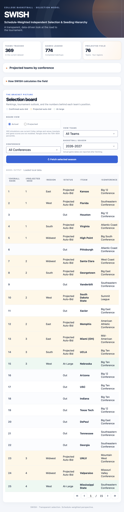

# SWISH

SWISH (Schedule-Weighted Independent Selection & Seeding Hierarchy) is a local
Dash app for exploring a college basketball selection model, projected tournament
field, and season simulations.



## Requirements

- Python 3.9 or newer
- Internet access to fetch game results and upcoming schedules from ESPN

## Run locally

From a terminal, move into the project directory and create a virtual environment:

```sh
python3 -m venv .venv
```

Activate it:

```sh
# macOS / Linux
source .venv/bin/activate

# Windows PowerShell
.venv\Scripts\Activate.ps1
```

Install dependencies and start the app:

```sh
python -m pip install -r requirements.txt
python ncaa_selection_app.py
```

Open [http://127.0.0.1:8050](http://127.0.0.1:8050) in a browser. Stop the
server with `Ctrl+C`.

## Data and projections

- Choose a basketball season and use **Fetch selected season** to load completed
  ESPN results. Fetching requires an internet connection.
- Fetched `teams.csv` and `games.csv` files are saved in the project directory
  and ignored by Git. They are local data and are not required to launch the app.
- The CSV templates (`teams_template.csv` and `games_template.csv`) are examples
  of the expected data format; the app does not load them as its live data files.
- If both local data files are not present, the app starts with sample data.
- The **Actual / Projected** board toggle simulates the remaining scheduled games
  for the selected season. Projection mode requires an internet connection and
  uses current Colley ratings and venue; it does not project game scores or
  unknown conference tournament brackets.
- The projected field is 68 teams through 2025–26 and 76 teams from 2026–27
  onward.

To start fresh with data, remove the local `teams.csv` and `games.csv` files and
fetch the desired season from the app.
